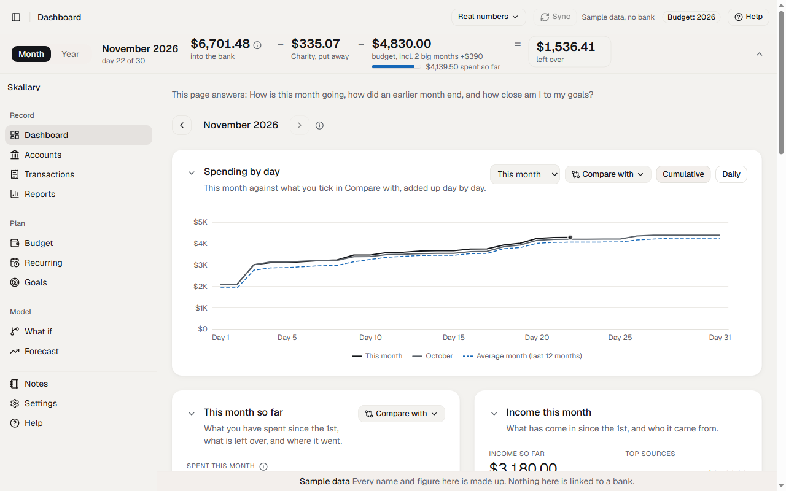
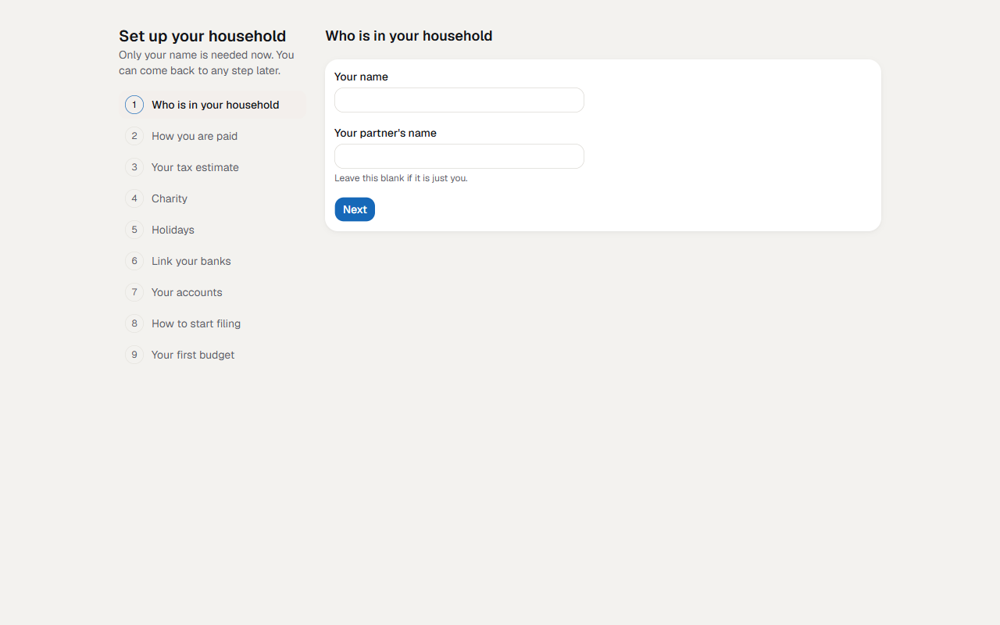
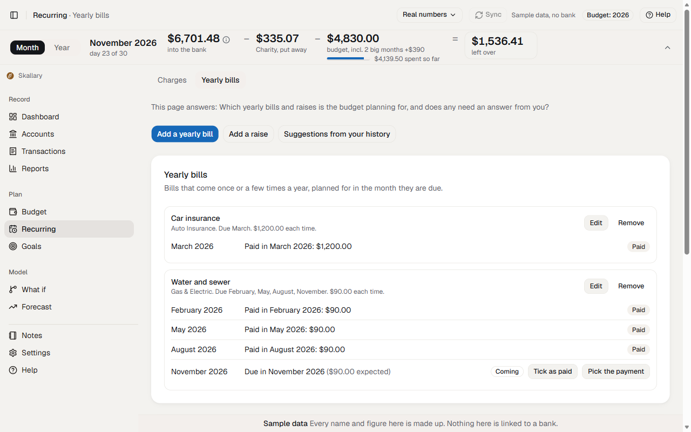
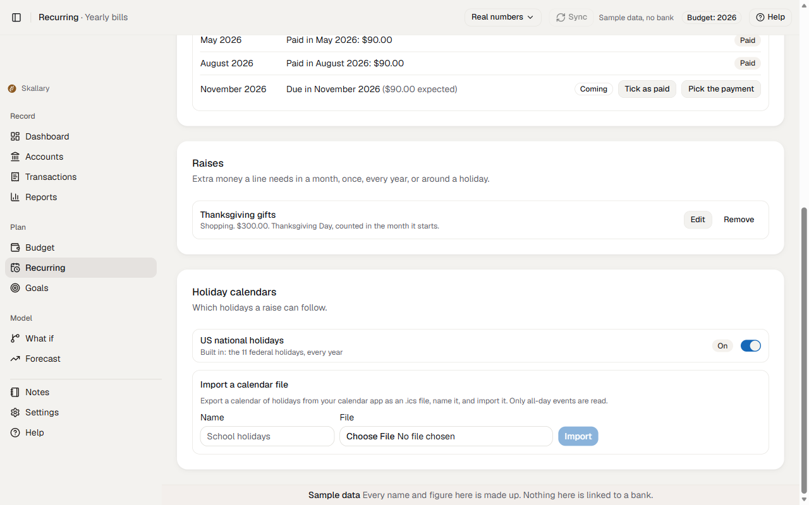
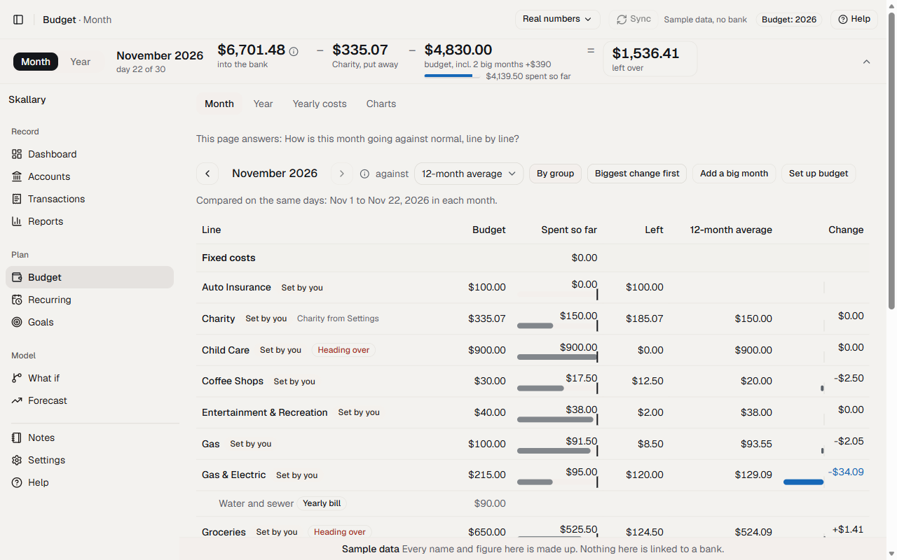
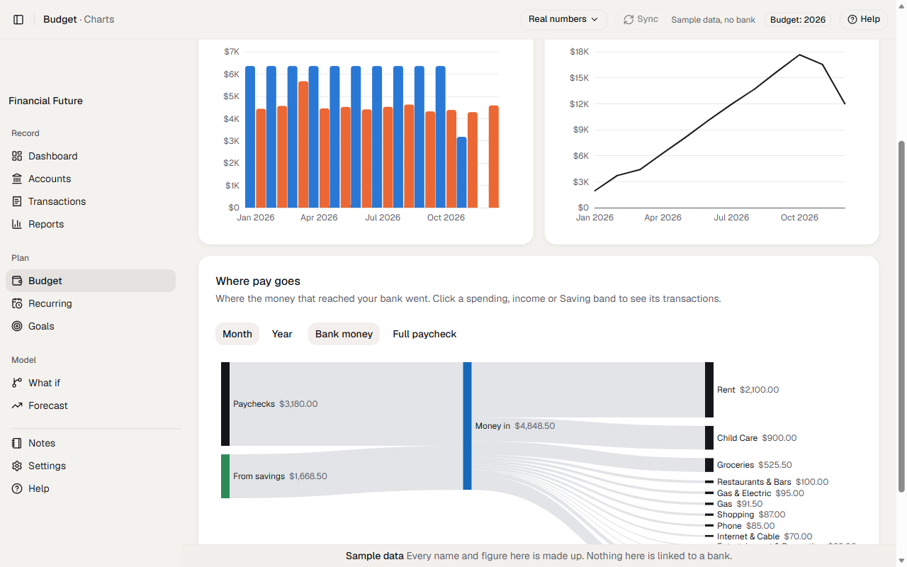
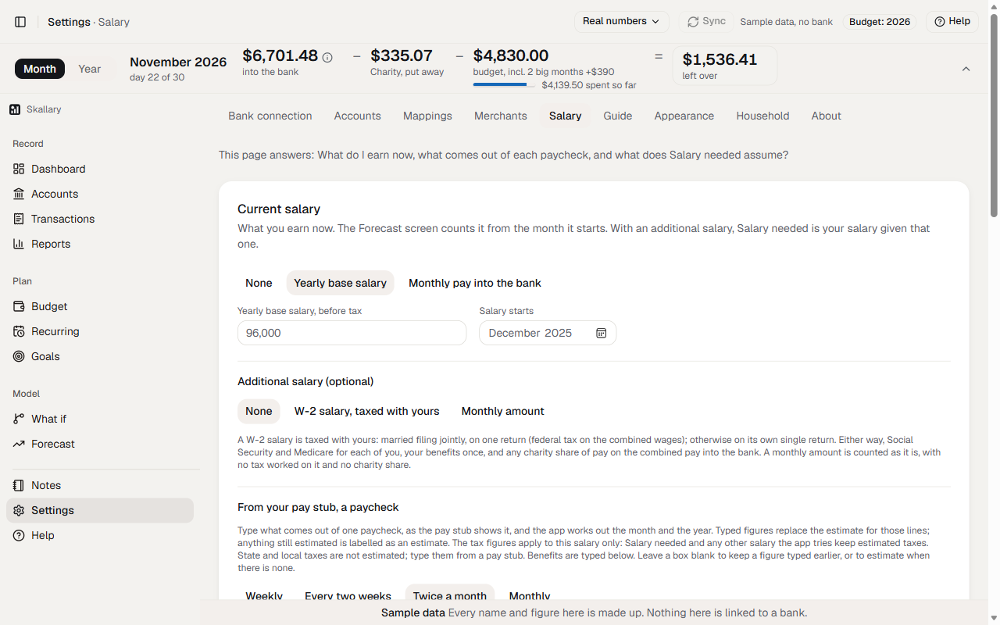

# Skallary

A budget and planning app that runs on your own Windows PC. Your numbers stay on your computer.

## What it is

Skallary reads your bank accounts, files each purchase under a category, and compares each month with the budget you set. It shows what you spent, what is left, where your pay went, and where the year is heading. It also plans for the bills that come once a year and for the months that cost extra, like a holiday.

It is for someone who likes working with numbers, is not a developer, and is willing to follow a careful guide once. You do not write or change any code to use it.



## What it does not do

Please read this before you install.

1. It runs on Windows only. Mac and Linux are untested.
2. It is for the United States only. The tax estimate and the built-in holidays are American.
3. It assumes you are paid a salary. Self-employed income and irregular pay are not planned for.
4. It is a personal project, shared as is. No support is promised, and nothing here is financial, tax, or legal advice.
5. Bug reports are welcome. Open an issue on this page and say what you did, what you expected, and what happened. Please leave out real account numbers and balances.

## Install

Skallary runs on 64-bit Windows and needs **Node.js 22 or newer (tested with 26)**, 64-bit (x64). If you already have Node.js 22, update to the latest 22 release before running setup.

### 1. Install Node.js and Git

Node.js runs the app. Git downloads it and lets you get updates. Install each tool once. You can use either option for each one.

To open a terminal, open the Windows Start menu, type **Terminal**, and press Enter. In Windows Terminal, use a **PowerShell** tab. You can also search for **Windows PowerShell** and open it directly.

**Node.js**

- In Windows Terminal or PowerShell, run:
  ```powershell
  winget install --id OpenJS.NodeJS.LTS --exact --architecture x64
  ```
- Or download the **Windows Installer (.msi)** for **x64** from [nodejs.org](https://nodejs.org/en/download). Use the standard choices and leave the optional tools for native modules unchecked.

**Git**

- In Windows Terminal or PowerShell, run:
  ```powershell
  winget install --id Git.Git --exact
  ```
- Or download the Windows installer from [git-scm.com](https://git-scm.com/download/win) and use the standard choices.

Close the terminal and open a new PowerShell window. Run these one at a time to check that both are installed:

```powershell
node -v
git --version
```

### 2. Download and set up Skallary

In PowerShell, run each line in order. The first line goes to your Windows user folder, where Git will create a folder named **skallary**.

```powershell
cd $env:USERPROFILE
git clone https://github.com/m-mcohen/skallary
cd skallary
npm run setup
```

Setup downloads the app's packages and builds its screens. It may take a few minutes. It needs no Python or build tools. If PowerShell says running scripts is disabled, use `npm.cmd run setup`.

### 3. Start Skallary

In File Explorer, open the **skallary** folder and double-click **Start.cmd**. Or run `.\Start.cmd` from PowerShell in that folder. The app opens in your browser. Keep the Command Prompt window open while you use the app. Close it to stop the app.

## Try it with sample data first

You can look around before you set anything up. The sample is a made-up household. Nothing in it is real, and it cannot be linked to a bank.

1. Follow the install steps above through `npm run setup`.
2. In the **skallary** folder, double-click **Start-Sample.cmd**. In PowerShell, run `.\Start-Sample.cmd`.
3. The first time, it builds the sample data in a few seconds. A black window shows its progress.
4. Your browser opens with the sample household. The startup window closes on its own. A separate, minimized Command Prompt window keeps the sample running.
5. To stop the sample, open its minimized Command Prompt window from the taskbar and close it. Closing the browser tab leaves the sample running.

The sample keeps its own data in a separate folder, so it never mixes with your own.

## The first-run interview

The first time you start the app, it asks a short set of questions. Only your name is required. You can skip every other step and come back later: a screen that needs an answer you skipped shows a small "set this up" card that takes you to the step. Everything can be changed later in Settings.



1. **Who is in your household.** Type your name. Add a partner's name, or leave it blank if it is just you. With no partner, the partner is hidden everywhere.
2. **How you are paid.** Choose your yearly base salary or the amount that lands in your bank each month. Then say how often you are paid: weekly, every two weeks, twice a month, or monthly. If you have a pay stub, you can enter its figures to replace the estimates for those items.
3. **Your tax estimate.** Covered in its own section below.
4. **Charity.** Covered in its own section below.
5. **Holidays.** Covered in its own section below.
6. **Link your banks.** Covered in its own section below.
7. **Your accounts.** Say whose each account is (yours, your partner's, or shared) and what type it is, such as checking, savings, or credit card.
8. **How to start filing.** Choose how purchases get their categories. The first choice gives you standard categories and files purchases at well-known stores for you. The second gives you the categories only, and you file each purchase yourself. The third gives you the categories and lets you tick the stores you use from a list. If you skip this step, you get the second choice.
9. **Your first budget.** The app creates this year's budget and opens **Set up budget**. Review the suggested amounts from your spending history. Type in any missing amounts or replace suggestions with your own. Check the boxes for the changes you want to save, then click **Apply changes**. The button shows how many changes you selected.

You can start without bank history. Skip **Link your banks** if you want to start by hand. On **Set up budget**, enter what you expect to spend on each line you want to budget for, even if the suggested amount is zero. Click **Apply changes** to save your amounts.

## Linking your banks through SimpleFIN Bridge

SimpleFIN Bridge is a separate service that reads your bank accounts for you and hands the numbers to apps like this one. It costs about $15 a year, paid to SimpleFIN. This app has no other way to read your banks.

1. Sign up at SimpleFIN Bridge (https://beta-bridge.simplefin.org) and link your banks there.
2. Make a **setup token** there and copy it. A setup token is a long line of letters and numbers that lets one app read your linked accounts.
3. In the app's **Link your banks** step, press **Open the folder**. This opens the app's data folder, where it keeps your budget and bank records. To open it yourself, paste `%LOCALAPPDATA%\finance` into the File Explorer address bar and press Enter. Windows fills in the path to your account's app data folder.
4. Open Notepad and paste the token. Choose **File**, then **Save As**, and go to the app's data folder. Set **Save as type** to **All files** and save as `simplefin-token.txt`. This prevents Notepad from adding a second `.txt`.
5. Back in the app, press **Connect**.

The token unlocks every linked bank, so it stays on your computer as a file. It is never typed into a page of the app. Do not email it, post it, or put it in a shared folder.

After the first link, you can press **Sync** at the top of any screen to bring in new transactions.

## Yearly bills and raises

Some costs come once or a few times a year: car insurance, a water bill every three months, a membership. Others make one month cost more, like gifts in the holiday season. Open **Recurring**, then the **Yearly bills** tab.



- **Add a yearly bill.** Name it, pick the budget line it belongs to, and say the amount and the months it is due. The app plans for it in those months and marks it paid when it sees the payment in your bank.
- **Add a raise.** A raise is extra money a budget line needs. Pick the line and the amount, then choose when: once in a month, every year in a month, or around a holiday. A raise tied to a holiday repeats every year and moves with the holiday's month by itself. A holiday that spans two months counts in the month it starts, unless you change that.
- **Suggestions from your history.** The app looks at your past spending and proposes bills and raises. You accept or ignore each one.

## Charity

If you set money aside for charity, the app can plan for it. It is off until you switch it on, and you name it yourself.

1. Switch it on and type the name you want to see, for example "Charity".
2. Choose how much: a share of the pay that lands in your bank (a percent), a set amount each month, or a set amount each year.
3. Press Save.

It then appears as its own line in the budget and in the top bar. You can change it later in Settings, then Salary.

## The tax estimate

This step is optional. If you complete it, the app estimates your federal income tax, Social Security, and Medicare, so that take-home pay and the forecast are closer to real.

1. Choose how you file: single, married filing jointly, or head of household.
2. Type the number of children, from 0 to 10.

It is an estimate, not tax advice, and it will not match your return. State tax is not estimated. In **Settings**, then **Salary**, enter pay-stub figures to replace the estimates for those items. The app still estimates items you leave blank. If you skip this step, the screens that need it show a card that takes you back.

## Holidays

Some of your costs follow holidays. The app knows holidays in two ways.

- **US national holidays** are built in. They are the 11 federal holidays, and they come from fixed rules, so they never run out. Switch them on in the Holidays step, or later on the **Yearly bills** tab of Recurring under "Holiday calendars".
- **Any other calendar** comes from a file you choose. The app never goes online to fetch a calendar. It reads a file from your computer. The file must be an `.ics` file, which is the standard calendar file format. Each all-day entry in it becomes a named holiday on its date.



### Worked example: the Jewish holidays

1. In your browser, go to https://www.hebcal.com, a free site for Jewish calendars. Find its holidays section and its option to download a calendar file. The site changes its layout from time to time, so look for words like "Download" and "iCalendar" or ".ics".
2. Choose the holidays you want and a range of years that covers the next few years. Download the file. It ends in `.ics`.
3. In the app, open **Recurring**, then **Yearly bills**, and find **Holiday calendars**.
4. Under **Import a calendar file**, type a name such as "Jewish holidays". Choose the `.ics` file you downloaded, then import it.
5. The new calendar appears in the list with the dates it covers. Make sure its switch is on.
6. Now add a raise and choose one of those holidays. It follows the holiday's date every year for as long as the file covers.

The same steps work for any calendar that can be exported as an `.ics` file, such as school holidays or a holiday list from your employer. The app warns you when a calendar's dates are about to run out. When that happens, download a newer file and press **Replace from a new file** next to the calendar.

## A tour of the main screens

- **Dashboard** shows this month so far: income, spending, and where it went.
- **Budget, Month** compares each line with its budget and with your usual month.
- **Budget, Charts** shows monthly cash flow and a flow chart of where your pay went.
- **Settings** holds the bank connection, your accounts, your salary, charity, and how the app looks.







## Where your data lives, and how to back it up

Everything you enter and everything your banks send is saved in one folder on your computer:

`%LOCALAPPDATA%\finance`

Paste that into the address bar of a File Explorer window to open it. The folder holds your database (`finance.db`) and, if you linked banks, your `simplefin-token.txt`. The app asks SimpleFIN for your transactions. It also fetches public mortgage rates from the St. Louis Fed's FRED service. The rate request sends only the names of the rate series.

To back up:

1. Close the app (close the black window).
2. Copy the whole `finance` folder to a USB drive or another safe place.
3. Treat the copy as private. It holds your finances and your bank token.

To restore, close the app and copy the folder back to the same place.

## Updating

Your budget and bank records live in your Windows app data folder (see "Where your data lives"). Updating the app leaves that folder in place.

1. Close the Command Prompt window that is running Skallary. If the sample is running, close its window too.
2. In File Explorer, open the **skallary** folder. Click the address bar, type `powershell`, and press Enter.
3. Run these commands one at a time:
   ```powershell
   git pull
   npm run setup
   ```
   If PowerShell says running scripts is disabled, use `npm.cmd run setup`.
4. Double-click **Start.cmd** to open the updated app.

## Known issues

The sample launcher cannot run if your Windows app data folder path contains an apostrophe. The regular app can still run.

## License

Skallary. Copyright (C) 2026 m-mcohen.

This app is free software, shared under the GNU Affero General Public License, version 3 or (at your option) any later version. The full text is in the `LICENSE` file.

In plain words:

1. You can use it, change it, and share it, for yourself or with others.
2. If you share a changed version, or run a changed version for other people over the internet (for example as a website), you must offer them its source code under the same license.
3. It comes with no warranty: it is shared as is, without support.

This summary is for convenience. The `LICENSE` file is what counts.
